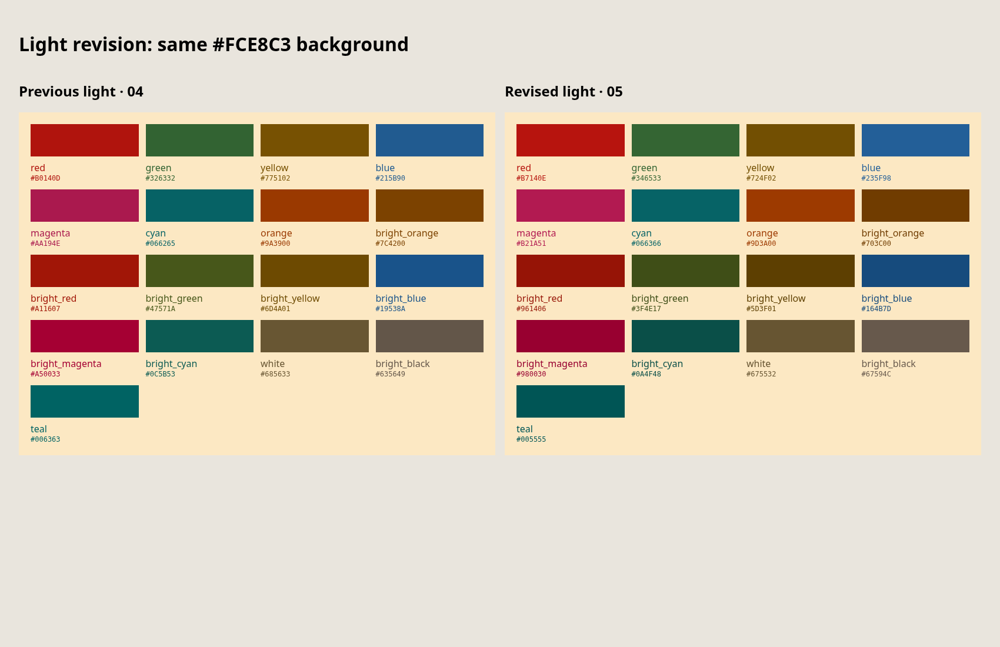
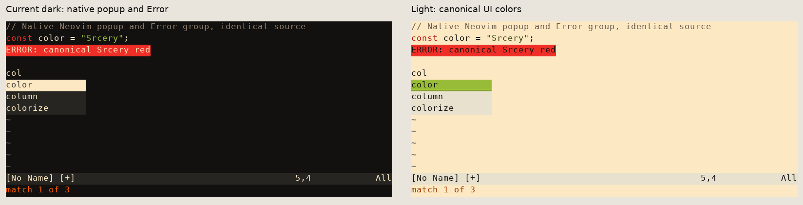
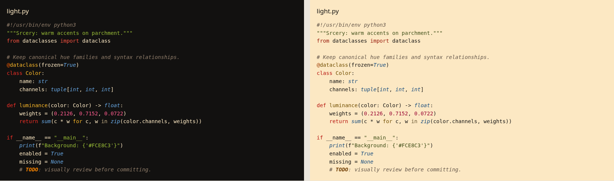
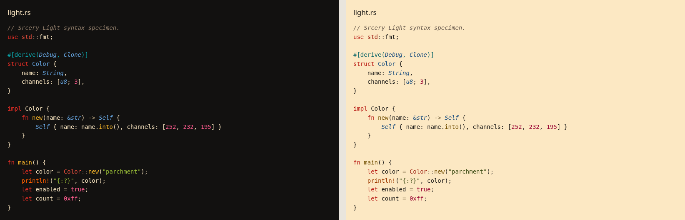
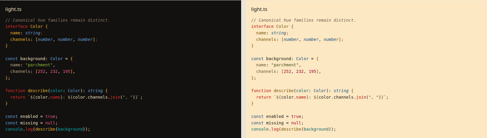
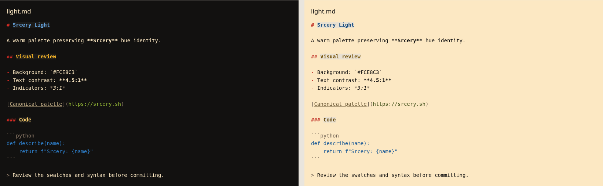
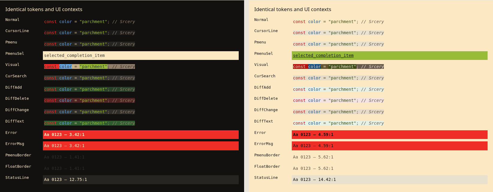
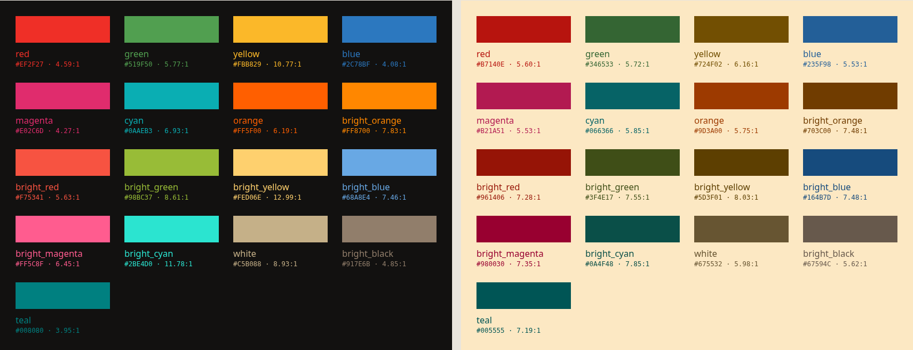

# Dark/light comparison

Left: current `srcery.vim`; right: light iteration 05.

Identical source fixtures, Vim syntax IDs and font settings. Neovim dark capture is also retained. These are rendered syntax specimens, not editor screenshots or Tree-sitter parser runs.

The native popup image is rendered from Neovim ext_linegrid events after calling complete(). Error red is identical on both sides. The light selected popup uses exact canonical bright green; that is a new explicit selection choice rather than the unchanged dark default.

| Group | Current dark FG | Dark ratio | Unchanged accent on parchment | Light FG | Light ratio |
|---|---|---:|---:|---|---:|
| Boolean | #FF5C8F | 6.45 | 2.43 | #980030 | 7.35 |
| Character | #519F50 | 5.77 | 2.72 | #346533 | 5.72 |
| Comment | #917E6B | 4.85 | 3.23 | #67594C | 5.62 |
| Conditional | #EF2F27 | 4.59 | 3.42 | #B7140E | 5.60 |
| Constant | #FF5C8F | 6.45 | 2.43 | #980030 | 7.35 |
| Decorator | #FF8700 | 7.83 | 2.00 | #703C00 | 7.48 |
| Define | #FF5F00 | 6.19 | 2.54 | #9D3A00 | 5.75 |
| Delimiter | #917E6B | 4.85 | 3.23 | #67594C | 5.62 |
| Exception | #EF2F27 | 4.59 | 3.42 | #B7140E | 5.60 |
| Float | #FF5C8F | 6.45 | 2.43 | #980030 | 7.35 |
| Function | #FBB829 | 10.77 | 1.46 | #724F02 | 6.16 |
| Identifier | #68A8E4 | 7.46 | 2.10 | #164B7D | 7.48 |
| Include | #F75341 | 5.63 | 2.79 | #961406 | 7.28 |
| Keyword | #EF2F27 | 4.59 | 3.42 | #B7140E | 5.60 |
| Label | #C5B088 | 8.93 | 1.76 | #675532 | 5.98 |
| Member | #68A8E4 | 7.46 | 2.10 | #164B7D | 7.48 |
| Number | #FF5C8F | 6.45 | 2.43 | #980030 | 7.35 |
| Operator | #C5B088 | 8.93 | 1.76 | #675532 | 5.98 |
| PreCondit | #0AAEB3 | 6.93 | 2.26 | #066366 | 5.85 |
| PreProc | #0AAEB3 | 6.93 | 2.26 | #066366 | 5.85 |
| Repeat | #FBB829 | 10.77 | 1.46 | #724F02 | 6.16 |
| Special | #2C78BF | 4.08 | 3.84 | #235F98 | 5.53 |
| SpecialChar | #FBB829 | 10.77 | 1.46 | #724F02 | 6.16 |
| SpecialComment | #2BE4D0 | 11.78 | 1.33 | #0A4F48 | 7.85 |
| Statement | #EF2F27 | 4.59 | 3.42 | #B7140E | 5.60 |
| StorageClass | #68A8E4 | 7.46 | 2.10 | #164B7D | 7.48 |
| String | #98BC37 | 8.61 | 1.82 | #3F4E17 | 7.55 |
| Structure | #0AAEB3 | 6.93 | 2.26 | #066366 | 5.85 |
| Tag | #2C78BF | 4.08 | 3.84 | #235F98 | 5.53 |
| Todo | #FF8700 | 7.83 | 2.00 | #703C00 | 7.48 |
| Type | #68A8E4 | 7.46 | 2.10 | #164B7D | 7.48 |
| Typedef | #E02C6D | 4.27 | 3.68 | #B21A51 | 5.53 |
| Variable | #FCE8C3 | 15.69 | 1.00 | #121110 | 15.69 |
